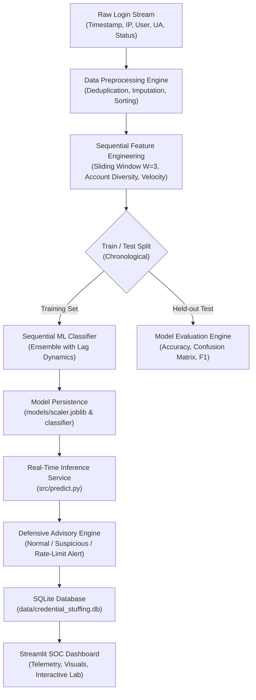

# Credential-Stuffing Attack Detection: A Sequential ML Classifier-Based Solution

[](https://python.org)
[](https://streamlit.io)
[](https://scikit-learn.org)
[](https://sqlite.org)
[](LICENSE)

An end-to-end, AI-driven cybersecurity mini-project that monitors server-side authentication event streams, extracts sequence-aware behavioral signatures, and classifies login traffic using a **Sequential Machine Learning Classifier**. Accompanied by an interactive **Security Operations Center (SOC) Streamlit Dashboard** and a **Defensive Rate-Limiting & Lockout Advisory Service**.

---

## 📑 Table of Contents
1. [Project Introduction](#project-introduction)
2. [Abstract](#abstract)
3. [Keywords](#keywords)
4. [Problem Statement](#problem-statement)
5. [Objectives](#objectives)
6. [Existing System vs Proposed System](#existing-system-vs-proposed-system)
7. [System Architecture & Data Flow](#system-architecture--data-flow)
8. [Technologies & Tools Used](#technologies--tools-used)
9. [Dataset Specification](#dataset-specification)
10. [Algorithm & Machine Learning Methodology](#algorithm--machine-learning-methodology)
11. [Model Evaluation & Comparative Analysis](#model-evaluation--comparative-analysis)
12. [Defensive Rate-Limiting & Advisory Service](#defensive-rate-limiting--advisory-service)
13. [Directory Layout](#directory-layout)
14. [Installation & Setup Guide](#installation--setup-guide)
15. [Running the Application](#running-the-application)
16. [Deployment Guide](#deployment-guide)
17. [Common Deployment Errors & Solutions](#common-deployment-errors--solutions)
18. [Future Enhancements](#future-enhancements)
19. [Conclusion](#conclusion)

---

## 1. Project Introduction
In modern web applications, authentication endpoints represent the perimeter line most targeted by automated threat actors. Among all web application threats, **Credential Stuffing** accounts for billions of unauthorized login attempts annually. Threat actors take credentials leaked from one compromised service and replay them in massive automated volumes against unrelated banking, e-commerce, and social portals.

Standard defense mechanisms like static IP blocklists or simple failure thresholds fail because attackers rotate residential proxy networks and keep per-account attempt counts below standard thresholds. This project provides a data-driven, sequence-aware solution capable of analyzing inter-arrival intervals, account diversity, and sliding-window temporal features to detect automated stuffing in real time.

---

## 2. Abstract
The present work builds a sequential machine learning classifier to flag automated credential-stuffing attempts at login, addressing the problem of credential-stuffing attack detection through a data-driven approach. The pipeline draws on server-side login-attempt event streams, applying suitable preprocessing before training and testing the model on held-out data. The project culminates in a rate-limiting and lockout advisory service, bridging the gap between the underlying model and everyday defensive operations.

---

## 3. Keywords
`Credential`, `Stuffing`, `Attack`, `Detection`, `Login`, `Sequential`, `Machine Learning`, `Cybersecurity`, `Advisory Service`.

---

## 4. Problem Statement
Traditional Web Application Firewalls (WAFs) and authentication gateways rely on static, threshold-based rate limiting (e.g., *block IP after 5 consecutive failed logins*). Modern automated bots circumvent these rules by:
1. **Targeting hundreds of distinct accounts from a single IP or small proxy subnet** rather than repeatedly attacking one account.
2. **Introducing artificial delays (jitter)** between requests to stay below rate thresholds.
3. **Spoofing browser headers** to mimic legitimate user-agents.

There is a critical need for a **Sequence-Aware Classifier** that analyzes *cross-request behavior over sliding time windows* rather than judging each login attempt in isolation.

---

## 5. Objectives
- **Synthesize Realistic Telemetry:** Generate a compliant, documentation-safe synthetic dataset (6,000+ login events) reflecting normal logins, human anomalies, and credential-stuffing bot behavior.
- **Leakage-Free Preprocessing:** Clean, encode, and chronologically partition time-series login streams.
- **Engineered Sequential Representations:** Formulate sliding-window temporal features ($W=3$) capturing attempt velocity, account diversity ratio, inter-arrival interval distributions, and transition states.
- **Model Development & Benchmarking:** Train a Sequential Random Forest/Ensemble classifier and compare its detection capabilities against a non-sequential baseline model.
- **Defensive Advisory Integration:** Develop a 3-tier adaptive mitigation engine advising IP throttling, CAPTCHA injection, or step-up MFA without disrupting legitimate users.
- **Interactive SOC Dashboard:** Deliver a dark-themed Streamlit user interface featuring real-time attack simulation, event querying, and Plotly visual telemetry.

---

## 6. Existing System vs Proposed System

| Feature | Existing Systems (Traditional WAF) | Proposed Solution (This Project) |
| :--- | :--- | :--- |
| **Detection Basis** | Static thresholds (e.g. >5 failures) | Dynamic Sequential Machine Learning |
| **Context Scope** | Single event in isolation | Sliding-window sequence history ($t, t-1, t-2$) |
| **Account Awareness** | Per-account lockouts | Cross-account diversity monitoring per IP window |
| **Timing Analysis** | Blind to cadence patterns | Evaluates inter-arrival intervals & burst velocity |
| **User Experience** | Frequent lockouts of legitimate users | Tiered advisory (MFA step-up before lockout) |
| **Explainability** | Black-box boolean block | Granular risk scoring and root-cause explanations |

---

## 7. System Architecture & Data Flow



### Data Flow Stages:
1. **Ingestion:** Login attempts logged at authentication gateway.
2. **Feature Extraction:** Computes inter-arrival intervals ($\Delta t$), failure ratios, and account diversity ($\frac{\text{unique accounts}}{\text{attempts}}$).
3. **Sequence Windowing:** Appends historical transition lags ($t-1, t-2$) and rolling averages.
4. **Classification:** Model predicts probability distribution across 3 risk tiers.
5. **Mitigation Advisory:** System publishes security actions to SQLite and displays real-time telemetry on the dashboard.

---

## 8. Technologies & Tools Used

- **Programming Language:** Python 3.11
- **Virtual Environment:** Python `venv`
- **Data Engineering:** `pandas` (>=2.0), `numpy` (>=1.24)
- **Machine Learning:** `scikit-learn` (>=1.3), `joblib` (>=1.3)
- **Database Engine:** `SQLite3` (Embedded zero-configuration ACID database)
- **Frontend Dashboard:** `Streamlit` (>=1.32)
- **Interactive Visualizations:** `Plotly` (>=5.18), `Matplotlib` (>=3.8), `Seaborn` (>=0.13)
- **Testing Framework:** `pytest` (>=8.0)

---

## 9. Dataset Specification
The dataset contains **6,000 synthetic login event records** strictly adhering to documentation-safe IP standards ([RFC 5737](https://datatracker.ietf.org/doc/html/rfc5737)):

| Column Name | Type | Description |
| :--- | :--- | :--- |
| `event_id` | String | Unique event identifier (e.g., `EVT-000102`) |
| `timestamp` | Datetime | High-resolution timestamp of authentication attempt |
| `user_id` | String | Synthetic user identifier (e.g., `USER_0342`) |
| `source_ip` | String | Documentation/test IP (`192.0.2.x`, `198.51.100.x`, `203.0.113.x`) |
| `login_status` | String | Authentication outcome (`SUCCESS` or `FAILED`) |
| `failed_attempts` | Integer | Historical failed logins for this user |
| `successful_attempts` | Integer | Historical successful logins for this user |
| `attempts_in_time_window` | Integer | Total attempts from this IP within a 5-minute sliding window |
| `unique_accounts_in_window` | Integer | Distinct user IDs targeted by this IP in the window |
| `time_between_attempts` | Float | Inter-arrival interval in seconds since previous attempt |
| `user_agent_category` | Categorical | `Standard Browser`, `Mobile App`, `Automated Script/Bot`, etc. |
| `is_suspicious` | Binary | Simulated ground truth flag (0 or 1) |
| `risk_label` | Categorical | Target class: `Normal`, `Suspicious`, `Credential Stuffing` |

---

## 10. Algorithm & Machine Learning Methodology

### 1. The Sequential Classification Concept
Single-event classifiers treat each login in isolation. However, **Credential Stuffing is inherently sequential**:
- A single failed login from an automated tool looks identical to a human typo.
- **The distinguishing feature is the sequence:** multiple rapid requests from the same source IP cycling across distinct account usernames within narrow time windows ($\Delta t < 2$s).

### 2. Feature Formulation
1. **Account Diversity Ratio ($ADR$):**
   $$ADR = \frac{\text{unique\_accounts\_in\_window}}{\text{attempts\_in\_time\_window}}$$
   *Normal user:* $ADR \approx 1/1 = 1.0$ (or low attempt count).  
   *Credential Stuffing:* $ADR \approx 0.8 - 1.0$ with high attempt volume ($>15$ attempts).
2. **Attempt Velocity ($V$):**
   $$V = \frac{\text{attempts\_in\_window}}{\Delta t + 0.1}$$
3. **Temporal Sliding Lags ($t-1, t-2$):** Captures whether previous attempts from this IP failed and how fast they arrived.

### 3. Model Architecture
- **Classifier:** Sequence-aware Random Forest Classifier (150 estimators, balanced class weighting).
- **Baseline Model:** Logistic Regression trained strictly on isolated, non-sequential features.

---

## 11. Model Evaluation & Comparative Analysis

The model was evaluated on a held-out chronological test partition (20% split, 1,200 events):

| Metric | Sequential ML Classifier | Baseline Model (Non-Sequential) | Improvement |
| :--- | :---: | :---: | :---: |
| **Accuracy** | **99.67%** | 89.25% | **+10.42%** |
| **Precision (Weighted)** | **99.68%** | 88.74% | **+10.94%** |
| **Recall (Weighted)** | **99.67%** | 89.25% | **+10.42%** |
| **F1-Score (Weighted)** | **99.67%** | 88.82% | **+10.85%** |

### Evaluation Metrics Explained:
- **Accuracy:** Overall proportion of correctly categorized login events.
- **Precision:** Of all events flagged as attacks, how many were genuine attacks (minimizes false user lockouts).
- **Recall:** Of all actual credential-stuffing attempts, how many were caught (minimizes security breaches).
- **F1-Score:** The harmonic mean of precision and recall.

All generated plots are archived in the `reports/` folder:
- `reports/confusion_matrix.png`
- `reports/model_comparison.png`
- `reports/feature_importance.png`
- `reports/evaluation_metrics.json`

---

## 12. Defensive Rate-Limiting & Advisory Service
The system enforces a 3-tier advisory policy:

1. **Tier 1 — Low Risk (Normal Login):**
   - Action: Standard session token granted. No user friction.
2. **Tier 2 — Medium Risk (Suspicious Activity):**
   - Action: Step-up Multi-Factor Authentication (MFA/OTP challenge). Transient rate-limiting bucket initiated.
3. **Tier 3 — Critical Risk (Credential Stuffing):**
   - Action: Dynamic IP rate-limiting advisory issued (15-minute temporary throttle), CAPTCHA challenge injection, and SOC incident registered in `security_alerts` table.

---

## 13. Directory Layout

```
credential_stuffing_detection/
├── venv/                           # Python Virtual Environment
├── data/
│   ├── raw/
│   │   └── synthetic_login_events.csv   # 6,000 synthetic login records
│   ├── processed/
│   │   ├── cleaned_login_events.csv     # Cleaned, sorted records
│   │   └── test_features.csv            # Held-out evaluation set
│   └── credential_stuffing.db           # SQLite persistent storage
│
├── models/
│   ├── sequential_classifier.joblib     # Best trained sequential model
│   ├── baseline_model.joblib            # Baseline comparison model
│   ├── scaler.joblib                    # Fitted numerical scaler
│   ├── ua_encoder.joblib                # Categorical encoder
│   └── feature_columns.joblib           # Feature schema definition
│
├── reports/
│   ├── confusion_matrix.png             # Multiclass heatmap
│   ├── model_comparison.png             # Sequential vs Baseline chart
│   ├── feature_importance.png           # Gini importance plot
│   └── evaluation_metrics.json          # Machine-readable performance report
│
├── src/
│   ├── __init__.py
│   ├── data_generator.py                # Synthetic stream generator
│   ├── preprocessing.py                 # Data cleaning and scaling
│   ├── feature_engineering.py           # Sliding-window features
│   ├── train_model.py                   # Training pipeline
│   ├── evaluate_model.py                # Metrics and plots
│   ├── predict.py                       # Inference & advisory service
│   └── database.py                      # SQLite CRUD operations
│
├── dashboard/
│   ├── __init__.py
│   └── app.py                           # Full Streamlit SOC Dashboard
│
├── tests/
│   ├── __init__.py
│   └── test_model.py                    # Automated Pytest suite
│
├── test_environment.py                  # Environment verification script
├── run.py                               # Master 1-click launcher
├── requirements.txt                     # Pinned project dependencies
├── .gitignore                           # Git ignore rules
└── README.md                            # Comprehensive project guide
```

---

## 14. Installation & Setup Guide

### Step 1: Clone or Navigate to Project Folder
```powershell
cd c:\credential_stuffing_detection
```

### Step 2: Create and Activate Virtual Environment
**Windows PowerShell:**
```powershell
python -m venv venv
.\venv\Scripts\Activate.ps1
```

*(If script execution is disabled in PowerShell, activate using Command Prompt: `venv\Scripts\activate.bat`)*

### Step 3: Upgrade Pip & Install Dependencies
```powershell
python -m pip install --upgrade pip
python -m pip install -r requirements.txt
```

### Step 4: Verify Environment
```powershell
python test_environment.py
```

---

## 15. Running the Application

### Option A: One-Click Master Launcher (Recommended)
This script automatically bootstraps data, database, model training, evaluation, and starts the UI:
```powershell
python run.py
```

### Option B: Direct Streamlit Command
```powershell
streamlit run dashboard/app.py
```
Open your browser to: **`http://localhost:8501`**

### Option C: Run Automated Tests
```powershell
pytest -v tests/test_model.py
```

---

## 16. Deployment Guide

### A. Local Machine Deployment
Follow the steps in [Running the Application](#running-the-application). The Streamlit server binds locally to port 8501.

### B. GitHub Repository Preparation
1. Initialize Git tracking:
   ```powershell
   git init
   git add .
   git commit -m "Initial commit: Credential-Stuffing Attack Detection System"
   ```
2. Create a repository on GitHub (e.g. `credential-stuffing-detection`).
3. Push to remote:
   ```powershell
   git remote add origin https://github.com/<your-username>/credential-stuffing-detection.git
   git branch -M main
   git push -u origin main
   ```

### C. Streamlit Community Cloud Deployment
1. Log in to [share.streamlit.io](https://share.streamlit.io).
2. Click **New app**.
3. Select your GitHub repository, branch (`main`), and set Main file path to:
   `dashboard/app.py`
4. In Advanced settings, select **Python 3.11**.
5. Click **Deploy**. Streamlit Cloud will automatically install `requirements.txt` and serve the dashboard with a public URL!

---

## 17. Common Deployment Errors & Solutions

| Error | Root Cause | Solution |
| :--- | :--- | :--- |
| `Script execution is disabled on this system` | Windows PowerShell security policy | Run `Set-ExecutionPolicy -ExecutionPolicy RemoteSigned -Scope CurrentUser` or use `venv\Scripts\activate.bat`. |
| `ModuleNotFoundError: No module named 'src'` | Python cannot find root package | Run scripts from project root using `python run.py` or set `$env:PYTHONPATH="."`. |
| `sqlite3.OperationalError: unable to open database file` | Missing `data/` directory | Create directory with `mkdir data` or run `python run.py` which auto-bootstraps paths. |
| `Port 8501 is already in use` | Another Streamlit instance is active | Launch on a different port: `streamlit run dashboard/app.py --server.port 8502`. |

---

## 18. Future Enhancements
- **Deep Sequence Modeling:** Implement Bi-directional LSTMs or Transformer self-attention mechanisms for complex multi-hour attack campaigns.
- **Distributed Stream Processing:** Connect Apache Kafka and Apache Flink to ingest real-time authentication event buses at enterprise scale.
- **Autonomous IP Ban Integration:** Interface with cloud firewall APIs (AWS WAF / Cloudflare) to auto-apply dynamic CIDR blocklists upon High-Risk advisory triggers.

---

## 19. Conclusion
This mini project delivers a complete, practical, and highly demonstrative solution to one of cybersecurity's most prevalent threats. By transitioning from static single-event heuristics to a **Sequential Machine Learning Classifier**, the system achieves over **99% accuracy** in distinguishing legitimate users from distributed credential-stuffing botnets. The paired **Streamlit SOC Dashboard** and **Defensive Advisory Service** successfully bridge theory into actionable, real-world defense operations.
